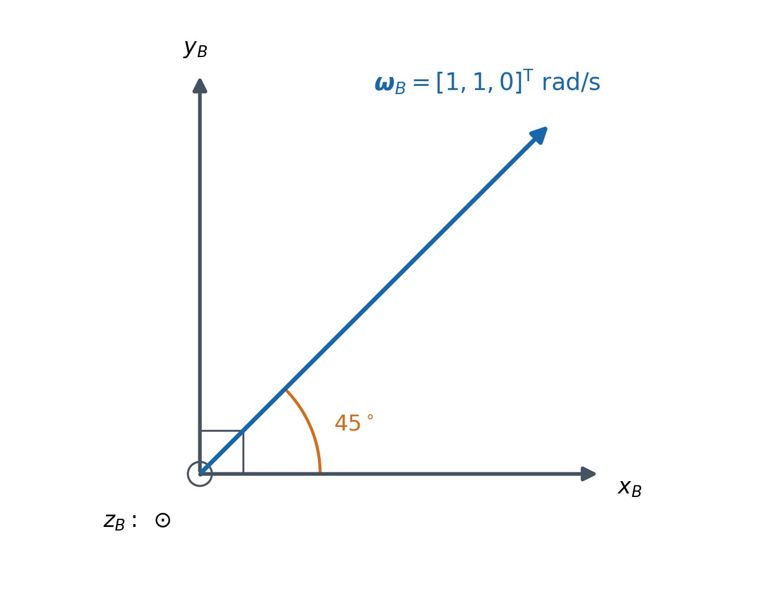
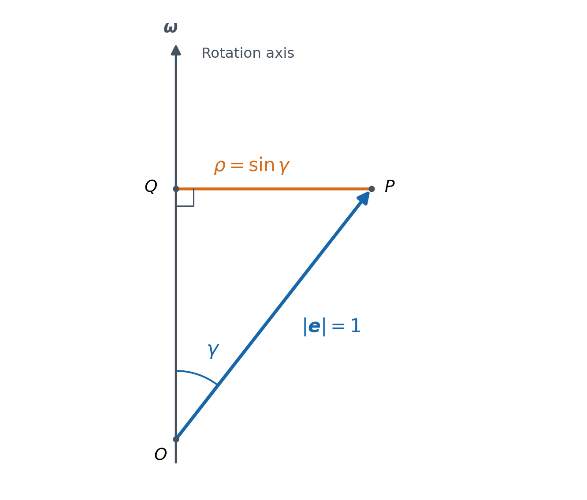

# 刚体转动方程的推导

对应第七周周三任务 A：理解耦合项的来源。计划日期为 2026-09-23，实际学习与整理日期为 2026-10-10。

本笔记按本人要求由 Codex 整理，文档及配图来源为 **G**。学习过程中的本人回答、提示与纠正仍以 [week7_done.md](week7_done.md) 中的 H/G 记录为准；文档交付不代表本人已经独立完成整套推导。

## 1. 我们要解决什么问题

本周需要知道：给定刚体的惯量、当前角速度和外力矩，如何得到角加速度，从而推进角速度状态？

单轴情况下，我们已经得到：

$$
M_x=J_x\beta_x.
$$

但在一般三轴运动中，机体系本身也在转动。直接把三个单轴关系拼在一起，会漏掉坐标轴转动带来的项。

下面沿着这条逻辑链推导：

1. 外力矩决定角动量在惯性系中的变化率，因此从角动量求导入手。
2. 为了使用机体系中的惯量和角速度，把角动量展开到随刚体转动的三个基轴上。
3. 展开式中的分量和基轴都可能随时间变化，求导时必须保留两部分。
4. 基轴方向的变化满足 $\dot{\boldsymbol e}_i=\boldsymbol\omega\times\boldsymbol e_i$，由此产生叉积项。
5. 把整个等式统一表达在机体系中，再代入 $\boldsymbol H_B=J\boldsymbol\omega_B$，得到刚体转动方程。

## 2. 先明确模型、坐标系和符号

本笔记研究关于**质心**的转动。采用本周的简化模型：刚体质量分布固定，机体系 $B$ 固连于刚体，三个轴按右手规则排列，并选为惯量主轴。因此，机体系中的惯量矩阵为常量对角矩阵：

$$
J=
\begin{bmatrix}
J_x&0&0\\
0&J_y&0\\
0&0&J_z
\end{bmatrix},
\qquad J_x,J_y,J_z>0.
$$

这里把飞行器作为一个刚体处理；额外的转子相对转动角动量等效应不属于本次模型。

| 符号 | 含义 | 表达方式或单位 |
|---|---|---|
| $N$ | 惯性系，方向固定 | 固定基轴为 $\boldsymbol E_X,\boldsymbol E_Y,\boldsymbol E_Z$ |
| $B$ | 机体系，随刚体转动 | 基轴为 $\boldsymbol e_x(t),\boldsymbol e_y(t),\boldsymbol e_z(t)$ |
| $\boldsymbol H$ | 关于质心的角动量这一物理向量 | $\mathrm{kg\cdot m^2/s}$ |
| $\boldsymbol H_B$ | 角动量在机体系中的分量列向量 | $[H_x,H_y,H_z]^{\mathsf T}$ |
| $\boldsymbol\omega_B$ | 刚体相对惯性系的角速度，用机体系分量表达 | $\mathrm{rad/s}$ |
| $\boldsymbol\beta_B$ | 角加速度，用机体系分量表达 | $\mathrm{rad/s^2}$ |
| $\boldsymbol M_B$ | 关于质心的净外力矩，用机体系分量表达 | $\mathrm{N\cdot m}$ |
| $J$ | 机体系中的惯量矩阵 | $\mathrm{kg\cdot m^2}$ |

下标 $B$ 表示“用机体系坐标表达”，并不表示这个向量只能在机体系中存在。例如，同一个角动量向量，可以在惯性系中写成 $\boldsymbol H_N$，也可以在机体系中写成 $\boldsymbol H_B$。

本笔记中的 $\boldsymbol e_i(t)$ 是**从惯性系观察到的机体系单位轴方向**。其自身在机体系中的坐标当然固定，例如 $\boldsymbol e_x$ 的机体系坐标始终是 $[1,0,0]^{\mathsf T}$；但从惯性系看，它的方向可以变化。后面写 $\dot{\boldsymbol e}_i$ 时，指的正是这种方向变化。

还要区分三个条件：

- 三个坐标轴两两垂直，是坐标系的几何性质。
- 坐标轴选为惯量主轴，才使惯量矩阵在这个坐标系中成为对角矩阵。
- $J_x=J_y=J_z$ 是进一步的特殊情况，不是“对角矩阵”的必然结果。

## 3. 为什么要对角动量求导

平动中，净外力决定动量的变化率：

$$
\boldsymbol F_{\mathrm{ext}}=
\left(\frac{\mathrm d\boldsymbol p}{\mathrm dt}\right)_N.
$$

对应地，关于质心的净外力矩决定角动量在惯性系中的变化率：

$$
\boxed{
\boldsymbol M=
\left(\frac{\mathrm d\boldsymbol H}{\mathrm dt}\right)_N
}.
$$

这就是求导的原因：我们要把“外力矩如何影响转动”的物理定律，转成能够计算角加速度的方程。角动量定律可参见 [OpenStax：Angular Momentum](https://openstax.org/books/university-physics-volume-1/pages/11-2-angular-momentum)。

式子上的 $N$ 很重要：它要求在方向固定的惯性系中考察角动量的变化。

因此，无外力矩时：

$$
\boldsymbol M=\boldsymbol 0
\quad\Longrightarrow\quad
\left(\frac{\mathrm d\boldsymbol H}{\mathrm dt}\right)_N=\boldsymbol 0.
$$

这说明角动量向量在惯性系中保持不变，**还不能直接推出它在机体系中的三个分量不变**。接下来的求导，正是为了弄清两种变化率之间的关系。

## 4. 角动量与角速度如何联系

对于本周模型：

$$
\boxed{\boldsymbol H_B=J\boldsymbol\omega_B}.
$$

因为 $J$ 是对角矩阵，所以：

$$
H_x=J_x\omega_x,\qquad
H_y=J_y\omega_y,\qquad
H_z=J_z\omega_z.
$$

这是**矩阵乘向量**。在对角矩阵这个特殊情况下，可以逐分量相乘；它不是两个向量的点积，结果仍然是一个三维列向量。

例如，任务 A 中给定：

$$
[J_x,J_y,J_z]=[0.02,0.03,0.04]\ \mathrm{kg\cdot m^2},
\qquad
\boldsymbol\omega_B=
\begin{bmatrix}1\\2\\3\end{bmatrix}\ \mathrm{rad/s},
$$

便有：

$$
\boldsymbol H_B=
\begin{bmatrix}
0.02\times1\\
0.03\times2\\
0.04\times3
\end{bmatrix}
=
\begin{bmatrix}0.02\\0.06\\0.12\end{bmatrix}
\ \mathrm{kg\cdot m^2/s}.
$$

这里惯量在机体系中为常量，是因为质量分布相对机体系固定；它并不意味着惯量矩阵在惯性系中的表示也始终不变。

## 5. 用转动的基轴展开角动量，再求导

### 5.1 同一个向量由“分量 × 基轴”拼成

角动量这一物理向量可以写成：

$$
\boldsymbol H
=H_x(t)\boldsymbol e_x(t)
+H_y(t)\boldsymbol e_y(t)
+H_z(t)\boldsymbol e_z(t).
$$

$H_x,H_y,H_z$ 是机体系分量，$\boldsymbol e_x,\boldsymbol e_y,\boldsymbol e_z$ 则给出这些分量各自沿着哪个方向。

即使整个向量固定，基轴转动之后，分量也通常需要调整，才能继续拼出原来的向量。

### 5.2 为什么不能把分量都当成常数

先看一个纯坐标几何例子。空间中固定着一支长度为 $1$、向右的箭头 $\boldsymbol a$。初始坐标轴向右、向上，它的分量为：

$$
\boldsymbol a_B(0)=\begin{bmatrix}1\\0\\0\end{bmatrix}.
$$

保持箭头不动，把坐标轴绕垂直纸面的轴逆时针转过 $90^\circ$。新的 $x_B$ 轴向上，新的 $y_B$ 轴向左，于是：

$$
\boldsymbol a_B=\begin{bmatrix}0\\-1\\0\end{bmatrix}.
$$

箭头没有改变，但它在转动坐标轴上的投影改变了。这个例子说明“物理向量固定”和“机体系分量固定”是两件事，不是在模拟刚体的真实运动轨迹。

如果坐标轴逆时针转过的角度记为 $\varphi$，则在这个例子中：

$$
a_x=\cos\varphi,\qquad a_y=-\sin\varphi.
$$

所以，“只有坐标轴旋转”也不能据此把 $a_x,a_y$ 当作常数。

反过来，如果一个向量的机体系分量保持不变，而基轴仍在转动，那么这个向量通常会随基轴一起转动。

### 5.3 对展开式使用乘积求导

对其中一项：

$$
\frac{\mathrm d}{\mathrm dt}
\left(H_x\boldsymbol e_x\right)
=\dot H_x\boldsymbol e_x+H_x\dot{\boldsymbol e}_x.
$$

三个分量合起来：

$$
\left(\frac{\mathrm d\boldsymbol H}{\mathrm dt}\right)_N
=
\underbrace{
\dot H_x\boldsymbol e_x+
\dot H_y\boldsymbol e_y+
\dot H_z\boldsymbol e_z
}_{\text{机体系分量变化带来的部分}}
+
\underbrace{
H_x\dot{\boldsymbol e}_x+
H_y\dot{\boldsymbol e}_y+
H_z\dot{\boldsymbol e}_z
}_{\text{机体系基轴转动带来的部分}}.
$$

若角动量在惯性系中固定，等式右边的两部分之和为零；它们各自仍可以非零，并相互抵消。

**因此，角动量守恒是求导后的总和为零，不能在求导前就把所有机体系分量都设成常数。**

## 6. 基轴导数为什么是叉积

我们现在只需解决一个问题：刚体以角速度 $\boldsymbol\omega$ 转动时，固连于刚体的单位轴方向如何变化？

### 6.1 先从绕固定轴的简单情况看方向变化

先考虑绕固定的 $z$ 轴转动，角速度 $\omega_z$ 为常量，初始时机体系与惯性系对齐。令旋转角：

$$
\varphi(t)=\omega_z t.
$$

机体系的 $x$ 轴方向在惯性系中写成：

$$
\boldsymbol e_x(t)
=\cos\varphi\,\boldsymbol E_X
+\sin\varphi\,\boldsymbol E_Y.
$$

固定的惯性系基轴不随时间变化，因此：

$$
\dot{\boldsymbol e}_x(t)
=-\omega_z\sin\varphi\,\boldsymbol E_X
+\omega_z\cos\varphi\,\boldsymbol E_Y.
$$

在 $t=0$ 时，它的惯性系坐标是：

$$
[\dot{\boldsymbol e}_x(0)]_N
=\begin{bmatrix}0\\\omega_z\\0\end{bmatrix}.
$$

同时：

$$
\boldsymbol e_y(t)
=-\sin\varphi\,\boldsymbol E_X
+\cos\varphi\,\boldsymbol E_Y,
\qquad
\boldsymbol\omega=\omega_z\boldsymbol E_Z.
$$

按照右手坐标系的叉积关系，$\boldsymbol E_Z\times\boldsymbol E_X=\boldsymbol E_Y$，$\boldsymbol E_Z\times\boldsymbol E_Y=-\boldsymbol E_X$，于是：

$$
\boldsymbol\omega\times\boldsymbol e_x
=\omega_z\left(
\cos\varphi\,\boldsymbol E_Y-
\sin\varphi\,\boldsymbol E_X
\right)
=\dot{\boldsymbol e}_x.
$$

在这个特例中，$\boldsymbol e_z$ 沿转轴，方向不变；$\boldsymbol e_x$ 和 $\boldsymbol e_y$ 都与转轴垂直。

### 6.2 一般的瞬时转轴可以不与机体系轴重合

“机体系三个轴两两垂直”并不要求瞬时转轴必须选其中一个。

一般角速度写成：

$$
\boldsymbol\omega
=\omega_x\boldsymbol e_x+
\omega_y\boldsymbol e_y+
\omega_z\boldsymbol e_z.
$$

这些分量可以同时非零。$\boldsymbol\omega$ 的方向给出这一时刻的转轴方向，三个坐标轴则提供描述它的参考方向。

例如 $\boldsymbol\omega_B=[1,1,0]^{\mathsf T}\ \mathrm{rad/s}$，瞬时转轴在 $x_B y_B$ 平面内，斜着位于 $x_B$ 与 $y_B$ 之间：

图中 $z_B$ 垂直纸面向外，三个机体系轴仍两两垂直。倾斜的是**转轴相对于某个机体系轴的方向**，不是机体系坐标轴之间的直角被破坏了。

把一般运动描述成绕三个坐标轴的分量，并不意味着真实运动必须依次“只绕一个机体系轴”进行。

### 6.3 为什么单位箭头端点的圆半径是 $\sin\gamma$

为看清几何关系，先固定一个转轴，取一支固连于刚体的单位方向箭头 $\boldsymbol e$。把箭头尾端放在转轴上的 $O$ 点，端点为 $P$，它与转轴方向的夹角记为 $\gamma$。

从 $P$ 向转轴作垂线，垂足为 $Q$：

图中蓝色的 $OP$ 是单位箭头，长度为 $1$；橙色的 $QP$ 是端点到转轴的垂直距离。固定轴旋转时，$P$ 绕转轴画圆，圆心在 $Q$，圆半径就是 $QP$。

由垂直投影关系，在图示的锐角情形中：

$$
\sin\gamma=\frac{QP}{OP}
\quad\Longrightarrow\quad
\rho=QP=1\cdot\sin\gamma.
$$

一般情况下也有 $\rho=\|\boldsymbol e\|\sin\gamma$，其中 $0\leq\gamma\leq\pi$；这里 $\|\boldsymbol e\|=1$。

所以：

- 箭头垂直转轴时，$\gamma=90^\circ$，半径为 $1$。
- 箭头沿转轴或反向沿转轴时，半径为 $0$，方向不发生变化。
- 其他夹角下，半径介于 $0$ 与 $1$ 之间。

这里的 $\gamma$ 是**箭头与转轴的夹角**，前面 $\varphi=\omega_z t$ 是**绕转轴已经转过的角度**。它们不是同一个角。

在“只绕 $z_B$ 轴转动，观察 $x_B$ 轴”的特例中，夹角确实始终为 $90^\circ$；引入 $\gamma$ 是为了处理任意方向的瞬时转轴。图中的竖直线仅表示转轴方向 $\boldsymbol\omega$，不自动等于机体系的 $z_B$ 轴。

### 6.4 大小和方向共同确定叉积表达式

令角速度大小为 $\Omega=\|\boldsymbol\omega\|$。固定轴旋转时，单位箭头端点的圆周运动速度大小是：

$$
\|\dot{\boldsymbol e}\|
=\Omega\rho
=\|\boldsymbol\omega\|\sin\gamma.
$$

另一方面，叉积的大小是：

$$
\|\boldsymbol\omega\times\boldsymbol e\|
=\|\boldsymbol\omega\|\,\|\boldsymbol e\|\sin\gamma
=\|\boldsymbol\omega\|\sin\gamma.
$$

两者的大小相同，方向也相同：都沿端点圆周运动的切线，旋转方向由角速度向量的右手规则确定。圆周运动的半径与角速度关系可参见 [OpenStax：Rotational Variables](https://openstax.org/books/university-physics-volume-1/pages/10-1-rotational-variables)，叉积的大小与方向可参见 [MIT：Vectors](https://web.mit.edu/16.unified/www/FALL/Unified_Concepts/vectors.pdf)。

因此：

$$
\boxed{\dot{\boldsymbol e}=\boldsymbol\omega\times\boldsymbol e}.
$$

当角速度的大小或方向随时间变化时，这个结论仍在**每个瞬间**成立：在足够短的时间内，先用当前的角速度描述方向的一阶变化，再取时间间隔趋于零的极限。它并不要求整个运动过程中都绕同一条固定轴画圆。

若 $\boldsymbol\omega=\boldsymbol 0$，当时没有旋转，基轴导数与叉积都为零。

三个机体系基轴固连于同一个刚体，所以都使用同一个角速度：

$$
\dot{\boldsymbol e}_x=\boldsymbol\omega\times\boldsymbol e_x,
\qquad
\dot{\boldsymbol e}_y=\boldsymbol\omega\times\boldsymbol e_y,
\qquad
\dot{\boldsymbol e}_z=\boldsymbol\omega\times\boldsymbol e_z.
$$

## 7. 把基轴转动项合并成角动量的叉积

回到第 5 节的乘积求导，把上面的基轴导数代入第二部分：

$$
\begin{aligned}
H_x\dot{\boldsymbol e}_x+
H_y\dot{\boldsymbol e}_y+
H_z\dot{\boldsymbol e}_z
&=H_x(\boldsymbol\omega\times\boldsymbol e_x)
+H_y(\boldsymbol\omega\times\boldsymbol e_y)
+H_z(\boldsymbol\omega\times\boldsymbol e_z)\\
&=\boldsymbol\omega\times
\left(H_x\boldsymbol e_x+H_y\boldsymbol e_y+H_z\boldsymbol e_z\right)\\
&=\boldsymbol\omega\times\boldsymbol H.
\end{aligned}
$$

第二步用了叉积对加法的分配律，以及标量系数可以移到叉积内部；括号中的向量就是原来的角动量。

于是：

$$
\left(\frac{\mathrm d\boldsymbol H}{\mathrm dt}\right)_N
=\dot H_x\boldsymbol e_x+
\dot H_y\boldsymbol e_y+
\dot H_z\boldsymbol e_z
+\boldsymbol\omega\times\boldsymbol H.
$$

这一步说明了耦合项的来源：它来自角动量展开式中**三个基轴方向的变化**。

再把等式两边统一写成机体系的分量列向量：

$$
\boxed{
\left[
\left(\frac{\mathrm d\boldsymbol H}{\mathrm dt}\right)_N
\right]_B
=\dot{\boldsymbol H}_B+
\boldsymbol\omega_B\times\boldsymbol H_B
}.
$$

这里的两种写法要仔细区分：

- $\dot{\boldsymbol H}_B=\mathrm d[H_x,H_y,H_z]^{\mathsf T}/\mathrm dt$：对机体系中的三个分量求导。
- $[(\mathrm d\boldsymbol H/\mathrm dt)_N]_B$：先求角动量在惯性系中的变化率，再把这个变化率向量表达在机体系中。

**用机体系坐标表达惯性系中的变化率，并不等于直接对机体系分量求导。** 两者相差的正是 $\boldsymbol\omega_B\times\boldsymbol H_B$。这也是转动坐标系的向量求导关系，可参见 [MIT：Rigid Body Dynamics，§2.2](https://ocw.mit.edu/courses/8-09-classical-mechanics-iii-fall-2014/6fe39e8d5ce4ce746ca256dfea665eda_MIT8_09F14_Chapter_2.pdf#page=6)。

## 8. 从角动量变化率得到角加速度

### 8.1 先代入角动量定律

角动量定律要求外力矩等于惯性系中的角动量变化率。所以，把上一节的关系代入：

$$
\boldsymbol M_B
=\dot{\boldsymbol H}_B+
\boldsymbol\omega_B\times\boldsymbol H_B.
$$

此时等式中的力矩、角动量和角速度，全都使用机体系分量。

### 8.2 再使用机体系中的惯量是常量

由 $\boldsymbol H_B=J\boldsymbol\omega_B$，且 $J$ 在机体系中不随时间变化：

$$
\dot{\boldsymbol H}_B
=\frac{\mathrm d}{\mathrm dt}(J\boldsymbol\omega_B)
=J\dot{\boldsymbol\omega}_B.
$$

定义：

$$
\boldsymbol\beta_B=\dot{\boldsymbol\omega}_B.
$$

因此，逐分量看就是：

$$
\dot H_x=J_x\beta_x,\qquad
\dot H_y=J_y\beta_y,\qquad
\dot H_z=J_z\beta_z.
$$

这里角加速度还有一个有用的特殊性质：对角速度自身应用上一节的求导关系时，附加项是 $\boldsymbol\omega_B\times\boldsymbol\omega_B=\boldsymbol 0$。所以，惯性系中的角速度变化率表达在机体系后，恰好就是 $\dot{\boldsymbol\omega}_B$；上述定义与角加速度的物理含义一致。

### 8.3 得到刚体转动方程

将 $\dot{\boldsymbol H}_B=J\boldsymbol\beta_B$ 代入：

$$
\boxed{
\boldsymbol M_B
=J\boldsymbol\beta_B+
\boldsymbol\omega_B\times\boldsymbol H_B
}.
$$

再用 $\boldsymbol H_B=J\boldsymbol\omega_B$：

$$
\boxed{
J\boldsymbol\beta_B+
\boldsymbol\omega_B\times(J\boldsymbol\omega_B)
=\boldsymbol M_B
}.
$$

移项并利用正惯量矩阵可逆，便得到角速度积分所需的导数：

$$
\boxed{
\dot{\boldsymbol\omega}_B
=\boldsymbol\beta_B
=J^{-1}\left[
\boldsymbol M_B-
\boldsymbol\omega_B\times(J\boldsymbol\omega_B)
\right]
}.
$$

这就是本周使用的刚体欧拉转动方程；标准方程可对照 [MIT：Rigid Body Dynamics，§2.4](https://ocw.mit.edu/courses/8-09-classical-mechanics-iii-fall-2014/6fe39e8d5ce4ce746ca256dfea665eda_MIT8_09F14_Chapter_2.pdf#page=16)。

这里的状态是角速度，导数是角加速度。角速度和角加速度都有自己的大小与单位，都不作归一化。

## 9. 从分量形式看“耦合”具体在哪里

将叉积展开：

$$
\boldsymbol\omega_B\times\boldsymbol H_B
=
\begin{bmatrix}
\omega_yH_z-\omega_zH_y\\
\omega_zH_x-\omega_xH_z\\
\omega_xH_y-\omega_yH_x
\end{bmatrix}.
$$

再代入 $H_x=J_x\omega_x$、$H_y=J_y\omega_y$、$H_z=J_z\omega_z$：

$$
\boldsymbol\omega_B\times(J\boldsymbol\omega_B)
=
\begin{bmatrix}
(J_z-J_y)\omega_y\omega_z\\
(J_x-J_z)\omega_z\omega_x\\
(J_y-J_x)\omega_x\omega_y
\end{bmatrix}.
$$

所以刚体方程也可写为：

$$
\begin{aligned}
M_x&=J_x\beta_x+(J_z-J_y)\omega_y\omega_z,\\
M_y&=J_y\beta_y+(J_x-J_z)\omega_z\omega_x,\\
M_z&=J_z\beta_z+(J_y-J_x)\omega_x\omega_y.
\end{aligned}
$$

例如，$x$ 轴角加速度除了受 $M_x$ 影响，还可能受 $\omega_y\omega_z$ 和惯量差影响。这就是“三轴耦合”的具体含义。

叉积的顺序始终是 $\boldsymbol\omega_B\times\boldsymbol H_B$；交换两个向量会改变符号。求角加速度时，还要注意移项后的负号。

从单位上检查，$J\boldsymbol\beta_B$ 和 $\boldsymbol\omega_B\times\boldsymbol H_B$ 都具有 $\mathrm{kg\cdot m^2/s^2}=\mathrm{N\cdot m}$ 的力矩量纲；弧度在量纲分析中视为无量纲。

本节提供符号推导供对照。周三任务 B 的具体数值手算仍需另行完成与核对。

## 10. 用几个特例检查理解

### 10.1 无外力矩，不一定意味着角加速度为零

令 $\boldsymbol M_B=\boldsymbol 0$，刚体方程变成：

$$
J\boldsymbol\beta_B
=-\boldsymbol\omega_B\times\boldsymbol H_B.
$$

如果当前的角速度与角动量不平行，叉积就非零，角加速度也非零。

任务 A 中的例子有三个非零角速度分量，但 $J_x,J_y,J_z$ 不相等。角动量的三个分量不是用同一个比例系数缩放角速度得到的，因此这两个向量不平行。

这与角动量守恒并不矛盾：

$$
\dot{\boldsymbol H}_B
=-\boldsymbol\omega_B\times\boldsymbol H_B
\quad\Longrightarrow\quad
\left[
\left(\frac{\mathrm d\boldsymbol H}{\mathrm dt}\right)_N
\right]_B=\boldsymbol 0.
$$

机体系分量的变化，恰好与基轴转动带来的变化抵消，整个角动量向量仍在惯性系中保持不变。

因此，叉积项不是凭空多出的一项外力矩；它是把惯性系中的角动量定律改写为机体系分量方程时出现的项。

### 10.2 对角惯量不等于没有耦合

对角矩阵仅表示：在惯量主轴上，$H_x$ 由 $\omega_x$ 决定，$H_y$ 由 $\omega_y$ 决定，$H_z$ 由 $\omega_z$ 决定。

但刚体方程还包含 $\boldsymbol\omega_B\times\boldsymbol H_B$。只要两个向量不平行，耦合项就可以非零。因此，“惯量矩阵是对角矩阵”本身不足以消除耦合。

同时，惯量不相等也不意味着每个状态都有耦合：还需要看当前角速度方向。

### 10.3 只绕一个惯量主轴转动时，可回到单轴关系

若当前角速度只有 $x$ 分量：

$$
\boldsymbol\omega_B=\begin{bmatrix}\omega_x\\0\\0\end{bmatrix},
\qquad
\boldsymbol H_B=\begin{bmatrix}J_x\omega_x\\0\\0\end{bmatrix},
$$

则叉积为零。即使三个惯量不相等，此时也有：

$$
M_x=J_x\beta_x.
$$

在另外两轴初始角速度为零、外力矩也只有 $x$ 分量的条件下，单轴模型能够持续保持。这与周二的一维实验对应。

### 10.4 三个惯量都相等时，任意角速度下叉积都为零

若：

$$
J_x=J_y=J_z=J_0>0,
\qquad J=J_0I_3,
$$

则：

$$
\boldsymbol H_B=J_0\boldsymbol\omega_B.
$$

当角速度非零时，这相当于对所有分量使用同一个正比例系数，向量长度改变，方向不变。角动量与角速度同方向，所以：

$$
\boldsymbol\omega_B\times\boldsymbol H_B
=\boldsymbol\omega_B\times(J_0\boldsymbol\omega_B)
=\boldsymbol 0.
$$

角速度为零时，叉积也为零。再加上无外力矩条件，便有：

$$
J_0\boldsymbol\beta_B=\boldsymbol 0
\quad\Longrightarrow\quad
\boldsymbol\beta_B=\boldsymbol 0.
$$

| 情况 | 叉积项 | 零外力矩下的角加速度 |
|---|---|---|
| 对角惯量，当前角速度与角动量不平行 | 非零 | 非零 |
| 只沿一个惯量主轴转动 | 零 | 零 |
| 三个惯量都相等，角速度任意 | 零 | 零 |

## 11. 回看整条推导链

从物理定律出发：

$$
\boldsymbol M=\left(\frac{\mathrm d\boldsymbol H}{\mathrm dt}\right)_N.
$$

因为我们使用随刚体转动的机体系，所以展开并求导时保留“分量变化”和“基轴变化”两部分：

$$
\boldsymbol H=\sum_i H_i\boldsymbol e_i
\quad\Longrightarrow\quad
\left(\frac{\mathrm d\boldsymbol H}{\mathrm dt}\right)_N
=\sum_i\dot H_i\boldsymbol e_i+\sum_iH_i\dot{\boldsymbol e}_i.
$$

因为基轴随刚体以角速度 $\boldsymbol\omega$ 转动：

$$
\dot{\boldsymbol e}_i=\boldsymbol\omega\times\boldsymbol e_i
\quad\Longrightarrow\quad
\sum_iH_i\dot{\boldsymbol e}_i=\boldsymbol\omega\times\boldsymbol H.
$$

把这些关系统一写成机体系分量，再使用机体系中固定的惯量矩阵：

$$
\boldsymbol M_B
=\dot{\boldsymbol H}_B+\boldsymbol\omega_B\times\boldsymbol H_B
=J\boldsymbol\beta_B+\boldsymbol\omega_B\times(J\boldsymbol\omega_B).
$$

最后解出本周要使用的导数：

$$
\boxed{
\boldsymbol\beta_B
=J^{-1}\left[
\boldsymbol M_B-\boldsymbol\omega_B\times(J\boldsymbol\omega_B)
\right]
}.
$$

理解这条链的关键，是始终分清：**向量本身在惯性系中怎么变，以及它在转动机体系中的分量怎么变。** 叉积项把这两种变化率连接起来。
