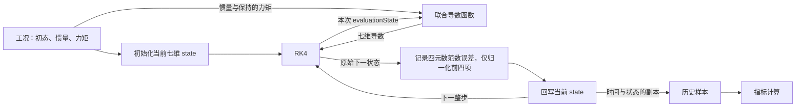

# 第 08 周进度汇报

## 执行情况

- 原计划周期：2026-09-28 至 2026-10-04。
- 实际执行区间：2026-10-13 开始，进行中。
- 预排 40 小时 / 实际有效投入：实际工时待本人填写。
- 健康与恢复：待本人填写。
- 已完成：周一物理量分类、联合状态含义与状态数量的局部问答；初始七维导数的计算过程由 Codex 直接给出，来源 G。
- 未完成：周一关系图、当前状态与历史样本的数据归属、第五周高度 PD 对照、接口草稿及第 74 题短复习；本周代码、轨迹与工程验收均未开始。
- 主动略过：本人明确要求暂时略过物理量单位，本次未验收单位掌握情况。

## 每日记录

| 原任务日期 | 实际执行日 | 完成内容与证据 | 未完成及原因 |
|---|---|---|---|
| 09-28 | 2026-10-13 | 本人正确指出力矩为输入；正确区分前四项姿态运动学导数与后三项角加速度；依据单位四元数约束回答姿态有 3 个独立变量、联合状态有 6 个独立变量。Codex 解释联合状态和 3 个转动自由度，并直接展开初始导数计算（G）。 | 周一整体仍在进行中；关系图、数据归属、PD 对照、接口及算法复习待完成。单位按本人要求略过。 |
| 09-29 | 2026-10-13 | Codex 新建联合导数头文件和源文件框架（G）；本人尚未填写核心代码。 | 当前待本人实现七维状态的维数检查；拆分、两项求导和组装尚未实现。 |
| 09-30 | | | 未开始 |
| 10-01 | | | 未开始 |
| 10-02 | | | 未开始 |
| 10-03 | | | 未开始 |

## 来源与当前能力

| 内容 | I/H/G | 本人完成或解释的部分 | 获得的帮助及未核对部分 |
|---|---|---|---|
| 七维状态、坐标系和单位 | H/G | 本人指出力矩是输入；在提示后正确区分导数的两部分，并回答 3 个姿态独立变量、6 个联合独立状态变量。 | 本人最初将 J 判为状态且认为不区分坐标系，Codex 纠正为机体系惯量参数；纠正后未要求本人重新解释。单位略过。3 个转动自由度的解释由 Codex 给出。 |
| 为什么联合保存姿态与角速度 | H/G | 本人指出：姿态相同而角速度不同，后续姿态变化不同；零角速度的一架保持姿态，有角速度的一架改变姿态。 | 联合状态含义、与高度及竖直速度的类比、共同求导与推进的说明由 Codex 提供。尚未检查本人对 RK4 中间状态的解释。 |
| 联合导数 | 框架 G，核心待本人尝试 | 本人已口头确认前四项是四元数导数，后三项是角加速度，并正确选择只读引用及按值返回。 | 声明、框架与导数排列由 Codex 整理；函数体当前只含未实现异常，核心尚未填写。 |
| 回调、积分与归一化 | 未开始 | | |
| 解析工况预测 | G | 本人明确要求直接给出计算过程和结果，并要求展开四元数乘法。 | 初始四元数导数、角加速度及七维导数由 Codex 给出；不计为本人独立计算，不代表轨迹已运行。 |
| 惯性系角动量解释 | 未开始 | | |
| 调试与 C++ 数据归属 | 未开始 | | |
| 检查、图和文档 | G / 未开始 | | 本周报由 Codex 整理；关系图、源码检查与工程验收尚未执行。 |

## 2026-10-13 追加：RK4 求值状态讨论

- Codex 展示了 RK4 与联合导数函数之间的局部关系图：RK4 传入七维 `evaluationState`，联合导数返回七维导数。图和说明来源 G，完整流程图尚未完成。
- 本人先回答应读取 `evaluationState` 的后三项，理由是角速度要不断更新；随后提出若每步初始角速度来自上一步结果，应使用工况初始角速度的疑问。
- Codex 区分工况初值、上一整步结束后保存的当前状态，以及 RK4 此次求值状态；给出第二次求值的角速度 `[0.985,2.01,2.9975]` 作为中间预测示例（G）。
- 本人指出保存状态与此次求值状态存在差别。Codex 补充：第一次求值使用本步起点，两者此时数值相同；中间求值使用预测状态。此前提问表述不清，未将该问答记为完整的独立解释验收。
- 同一次求值中，从同一份 `evaluationState` 读取四元数和角速度的规则已说明；回调代码尚未由本人实现，仍未验证实现能力。
- 当前接续点：补充流程图中的整步归一化节点，再继续当前状态回写与历史样本保存。归一化范围与理由待本人回答。

## 2026-10-13 追加：整步归一化范围

- 本人正确回答：完整 RK4 步后只归一化前四项四元数，保留后三项角速度。
- 本人给出的理由：角速度向量的长度代表大小，不能归一化成 1。该回答支持其对归一化范围和保留角速度物理大小的局部理解（H）；尚未实现归一化和状态回写代码。
- Codex 将规则整理为仅对 $q_{\mathrm{raw}}$ 除以其范数，角速度 $\omega_{\mathrm{raw}}$ 保持原值；完整流程图与样本保存尚未完成。
- 下一小步：用按值保存的简化样本类型说明历史样本与当前状态的数据归属，待本人回答。

## 2026-10-13 追加：历史样本与关系图

- 对简化类型 `Sample { double timeS; StateVector state; }` 和 `samples.push_back({timeS, state})`，本人正确回答：旧样本不会随外层当前状态改变，因为按值保存了副本。
- 该回答构成按值保存历史样本的数据归属解释证据（H）；示例类型与问题由 Codex 给出，尚未由本人编写或运行本周样本保存代码。
- 下图由 Codex 根据已经讨论的环节整理，来源 G。当前状态负责继续推进，历史样本保存各时刻的副本供指标计算；完整图尚未要求本人独立重画或解释。



- 初始化阶段也需要校验、归一化四元数并保存首个样本；本图重点展示整步推进和历史样本的数据归属，代码尚未实现。
- 下一小步：对照第五周高度 PD，解释未来角速度控制器应修改哪一个输入，以及实际状态由谁推进。待本人回答。

## 2026-10-13 追加：控制器输入与形式

- 对照第五周高度 PD，本人正确回答未来角速度控制器输出力矩，力矩通过角加速度影响实际角速度。该回答支持其对控制器输出与状态推进之间关系的局部理解（H）。
- Codex 补充：转动动力学根据输入力矩、当前角速度和惯量计算角加速度，再由积分器推进状态；三轴情形还包含刚体耦合项。
- 本人询问控制器是否都采用 P/I/D 形式，还是本项目默认采用 PID。
- Codex 说明（G）：PID 是控制器的一类形式，后续总体规划还安排状态反馈/LQR 和 MPC；不同方法可用于计算输入，不能将所有控制器都等同于 PID。
- 当前阶段边界：第五周正式高度控制器是 PD；本周单轴纸面反馈例子是 $M_x=k_\omega(\omega_{\mathrm{ref}}-\omega_x)$，只含 P；本周正式联合模型仍使用外部指定力矩，尚未实现角速度闭环或 PID 模块。
- 关系图及控制器概念连接已由 Codex 整理并获得上述局部问答证据；接口草稿仍待本人尝试，第 74 题短复习属于其他周一待办，尚未开展。

## 2026-10-13 追加：姿态反馈如何参与力矩计算

- 本人提出疑问：计算输入力矩时是否只考虑角速度，是否也需要考虑姿态。
- Codex 说明（G）：本周单轴 $M_x=k_\omega(\omega_{\mathrm{ref}}-\omega_x)$ 是角速度反馈例子；若目标是姿态跟踪，还需要利用姿态误差。串级形式可由姿态环产生期望角速度，再由角速度环产生力矩。
- 单轴示意由 Codex 给出（G）：$\omega_{\mathrm{ref}}=k_\phi(\phi_{\mathrm{ref}}-\phi)$，从而 $M_x=k_\omega[k_\phi(\phi_{\mathrm{ref}}-\phi)-\omega_x]$，最终力矩同时依赖姿态误差与当前角速度。
- 例子由 Codex 给出（G）：目标滚转角为零、当前滚转角为 10 度、角速度为零时，固定零角速度参考的角速度 P 环输出零力矩，不能主动纠正姿态偏差；姿态环根据负姿态误差产生负角速度参考，内环据此产生纠偏力矩。
- 也可用一个控制律直接联合使用姿态和角速度反馈，串级结构不是所有控制方法的必选形式。
- 本次是对本人问题的理论说明；未检查本人独立推导或解释能力，未实现姿态环或角速度环，不将其记为本周正式闭环实验已完成。

## 2026-10-13 追加：单轴二阶对象与串级控制

- 本人提出理解：可将姿态与角速度合成二阶系统进行控制，也可组织为两个一阶环节的串级闭环，并询问是否正确。
- Codex 确认其对单轴状态关系和串级组织的理解方向，并纠正术语：$\dot\phi=\omega_x$、$J_x\dot\omega_x=M_x$ 描述二阶被控对象；被控对象阶数不要求控制器具有相同阶数，PD 就可用于该理想单轴对象。
- Codex 给出的对应关系（G）：在恒定姿态参考、理想单轴模型且外环与内环均用 P 的条件下，$\omega_{\mathrm{ref}}=k_\phi(\phi_{\mathrm{ref}}-\phi)$、$M_x=k_\omega(\omega_{\mathrm{ref}}-\omega_x)$ 等价于 $M_x=K_p(\phi_{\mathrm{ref}}-\phi)-K_d\omega_x$，其中 $K_p=k_\omega k_\phi$、$K_d=k_\omega$。
- 串级结构中，角速度内环单独可表现为一阶闭环；接入姿态外环后，整个姿态闭环仍是二阶，不能将各环都视为互不关联的一阶闭环。
- 本次未要求本人独立推导上述参数对应关系，不记为单轴反馈误差方程和正式闭环实验已完成。

## 2026-10-13 追加：被控对象阶数与控制器阶数

- 本人追问：二阶系统是否必须由二阶控制器控制，以及是否存在“二阶控制器”的说法；此前关于控制器阶数的说明尚未被本人接受为已理解。
- Codex 核对 MathWorks 官方 model order、PID 和状态反馈文档后说明（G）：被控对象和控制器各自有自己的动态状态，二者阶数不要求相等；“二阶控制器”可指自身具有两个独立动态状态的动态控制器。
- 本周理想单轴对象以 $\phi$、$\omega_x$ 为两个状态，$J_x\ddot\phi=M_x$。若这两个状态已经作为反馈提供，则 $M_x=-K_p\phi-K_d\omega_x$ 只需代数计算，不新增控制器内部动态状态。
- Codex 直接代入得到（G）：$J_x\ddot\phi+K_d\dot\phi+K_p\phi=0$，说明反馈改变了二阶对象的闭环动态；这不是要求控制器也包含两个内部动态状态。
- 归一化教学例子（G，不是本周实际工况参数）：取 $J_x=1$、$K_p=1$、$K_d=2$，得到 $\ddot\phi+2\dot\phi+\phi=0$，解为 $\phi(t)=(c_1+c_2t)e^{-t}$，姿态和角速度均趋于零。未运行该例子的程序或仿真。
- 控制器阶数例子（G）：带积分和一阶微分滤波的 PID 可具有积分状态与滤波状态，因而可构成二阶动态控制器；P/I/D 构成项与动态阶数是不同的分类。
- 资料：[模型阶数](https://www.mathworks.com/help/control/ref/dynamicsystem.order.html)、[PID 并联形式及微分滤波](https://www.mathworks.com/help/control/ref/pid.html)、[状态反馈](https://www.mathworks.com/help/control/ref/lti.lqr.html)。
- 上述代入和术语说明由 Codex 直接给出，来源 G；尚未要求本人独立解释被控对象状态与控制器内部状态的区别。

## 2026-10-13 追加：状态与导数的区别及阶数搭配

- 本人仍不清楚动态状态的含义，提出 $J_x\ddot\phi=M_x$ 中是否只有 $\ddot\phi$ 一个独立状态，以及怎样判断动态状态数量；此前关于阶数的局部问答不作为已完整理解的证据。
- Codex 核对《Feedback Systems》官方 wiki 的状态定义与 MathWorks 状态空间说明后解释（G）：已知模型参数和后续输入时，状态应包含确定未来演化所需的当前信息。在本周理想单轴模型中，最小状态可取 $x=[\phi,\omega_x]^{\mathsf T}$，而 $\ddot\phi=M_x/J_x$ 是由输入和参数算出的导数，不另算一个独立状态。
- 直接改写的一阶状态方程（G）：$\dot x_1=x_2$、$\dot x_2=M_x/J_x$，其中 $x_1=\phi$、$x_2=\dot\phi$；需要分别给出 $\phi(0)$ 与 $\dot\phi(0)$ 两个独立初值。
- 零力矩反例（G）：若后续力矩始终为零，$\phi(t)=\phi(0)+\omega_x(0)t$。初态 $(0,0)$、$(0,1)$、$(1,0)$ 分别产生 $0$、$t$、$1$ 三条姿态轨迹，角加速度均为零。仅给角加速度不能确定轨迹。
- 判断规则（G）：先区分外部输入和固定参数，再将普通有限维常微分方程模型写成一阶状态方程，数需要独立初值和动态推进的变量；代数约束或可由当前状态与输入直接计算的量不额外增加独立状态。
- 不同阶数可搭配，但需要按具体闭环方程设计和验证，不能仅凭阶数认定能控制。可行组合包括一阶对象配带积分与一阶微分滤波的二阶 PID 控制器，以及二阶对象配带一阶微分滤波的一阶 PD 控制器；此处为结构举例，未运行本周实验。
- Codex 用本周理想单轴模型说明不能随意选控制律（G）：仅用 $M_x=-K_p\phi$ 且 $K_p>0$ 会得到 $J_x\ddot\phi+K_p\phi=0$，一般非零初值下持续振荡，缺少误差衰减；加入合适的角速度负反馈可产生阻尼。
- 资料：[状态定义](https://fbswiki.org/wiki/index.php/Question%3A_What_is_a_state%3F_How_does_one_determine_what_is_a_state_and_what_is_not%3F)、[状态变量与初值](https://www.mathworks.com/help/simulink/slref/simulink-concepts-models.html)、[状态空间表示](https://www.mathworks.com/help/control/ug/state-space-models.html)。
- 本次解释和例子均由 Codex 给出，来源 G；尚未取得本人纠正后独立说明状态定义、改写状态方程及选择控制器的证据。

## 2026-10-13 追加：对象、未知函数与动态状态

- 本人仍将方程 $J_x\ddot\phi=M_x$ 中的最高阶导数 $\ddot\phi$ 视为唯一状态，追问对象的含义以及二阶对象与二阶系统是否相同。状态定义和阶数的独立理解仍未通过，不因此前数量回答正确而上调能力记录。
- Codex 本次说明（G）：此处被控对象指飞行器的理想单轴滚转运动，输入为力矩 $M_x$，关注的输出为姿态角 $\phi$。从力矩计算角加速度只是模型中的即时计算环节，求未来姿态还需角速度与姿态两次积分。
- 用更简单的一阶方程说明（G）：$\dot y=1$ 中导数已经给定，而解 $y(t)=y(0)+t$ 仍需初值 $y(0)$；状态是需保存的 $y$，不是算出的常数导数。一个未知函数并不等同于一个动态状态。
- 本周单轴链条（G）：$M_x\rightarrow\ddot\phi=M_x/J_x\rightarrow\dot\phi\rightarrow\phi$。角速度积分需要初值 $\dot\phi(0)$，姿态积分需要初值 $\phi(0)$，因此最小状态可取 $[\phi,\dot\phi]^{\mathsf T}$。
- Codex 确认：对这条普通标量常微分方程，依据最高阶导数为二阶来判断模型是二阶是正确的；需纠正的是将最高阶导数当作唯一状态。方程中仅有一个未知函数 $\phi(t)$，但描述其运动需要两个独立初值。
- 术语说明（G）：二阶系统描述模型的动态阶数；二阶被控对象强调这个二阶系统在控制结构中承担被控制的角色。此处两个说法都指这个单轴运动模型，不能自动将所有控制器或整个闭环的阶数混为一谈。
- 本次说明由 Codex 直接提供，尚未取得本人重新解释状态、导数及对象阶数的证据；周一接口草稿仍未开展。

## 实验结果

- 当前仅完成初始导数的纸面参考计算；未运行联合模型。
- 初始计算使用：$J=\operatorname{diag}(0.02,0.03,0.04)$，$M_B=[0,0,0]^{\mathsf T}$，$q_{NB}(0)=[1,0,0,0]^{\mathsf T}$，$\omega_B(0)=[1,2,3]^{\mathsf T}$。
- 每工况积分次数 / 样本数：尚无本周实际运行数据。
- Codex 直接给出的初始计算（G）：
  - 四元数乘法：$[1,0,0,0]\otimes[0,1,2,3]=[0,1,2,3]$。
  - $\dot q_{NB}(0)=[0,0.5,1,1.5]^{\mathsf T}$。
  - $H_B(0)=J\omega_B(0)=[0.02,0.06,0.12]^{\mathsf T}$。
  - $\omega_B(0)\times H_B(0)=[0.06,-0.06,0.02]^{\mathsf T}$。
  - $\beta_B(0)=[-3,2,-0.5]^{\mathsf T}$。
  - $\dot x(0)=[0,0.5,1,1.5,-3,2,-0.5]^{\mathsf T}$。
- 程序初始导数值：尚未执行本周程序核对。

| 工况 | 解析或物理参考 | 数值结果 | 全轨迹最大误差或相对变化 |
|---|---|---|---|
| 静止 | 见本周计划 | 未运行 | 未统计 |
| 初始偏航后机体滚转 | 见本周计划 | 未运行 | 未统计 |
| 恒定正滚转力矩 | 见本周计划 | 未运行 | 未统计 |
| 无力矩三轴耦合 | 上述初始七维导数；全轨迹检查动能及惯性系角动量向量 | 未运行 | 未统计 |

- 归一化前 / 后四元数范数误差：未统计。
- 动能与惯性系角动量向量变化：未统计。
- 一次预测、一次错误定位及结果：尚未开展程序任务。
- 本人运行的构建与测试命令、结果：本周尚无；编译和构建仍由本人执行。
- 尚未验证的部分：联合导数、RK4 回调与循环、归一化、四工况轨迹、CSV 导出和回归结果。

## 算法

| 题号 | 新题或复习 | AC 与实际用时 | 帮助 | 本人等级 | 正确性或边界解释 |
|---|---|---|---|---|---|
| 74 | 计划短复习，未执行 | 未新增运行证据；保留既有 AC | 本周未开始 | 保留既有 C | 本周待复习 |
| 94 | 计划新题，未执行 | | | | |
| 104 | 计划新题，未执行 | | | | |
| 35、155 | 计划短复习，未执行 | | | | |

## 下周入口

- 当前 commit 与未提交修改：本次未提交；已有第八周计划修改及修订文档删除保持原状，本次新增本周报。
- 当前接续点：周一初始七维导数参考计算之后，继续组织物理关系图和说明当前状态、历史样本的数据归属。
- 本周真正理解的控制或旋转概念：已有上述局部问答证据；不扩写为全部联合积分能力已验收。
- 仍需帮助的具体问题：本人曾询问为何将姿态与角速度放进同一个状态，以及四元数乘法如何逐项计算；已得到说明，数值计算来源仍为 G。
- 是否具备连接平动、转动模型的条件：本周联合模型与验收尚未完成，暂不作通过判断。
- 希望调整的任务：本人暂时略过单位，并要求直接展示本阶段数值计算过程。

## 2026-10-13 当前接续点：周一接口草稿

- 已核对当前 `integrators.hpp`、`rotational_dynamics.hpp`、`attitude_kinematics.hpp`：`StateVector` 为 `Eigen::VectorXd`；惯量使用 `RotationalParameters`，力矩使用 `RotationalInput`。
- 下一步由本人尝试 `attitudeRateDerivative` 的函数声明：接收时间、七维求值状态、惯量参数和力矩输入；计算并返回新的七维导数，输入保持只读。尚未提交声明供审查。
- 本步只做接口草稿，联合导数函数体仍未实现；本周尚未构建或运行程序。
- 物理关系图、初始导数数值、控制器形式与状态阶数说明中直接提供的内容仍为 G；本人对状态定义和阶数的独立解释仍未核验，不因“下一步”而记为已经掌握。
- 周一接口草稿待完成，第 74 题短复习尚未开展。

## 2026-10-13 17:22 追加：接口草稿补全

- 17:22 取自本人消息提供的时间，不据此推算实际投入时长。
- 本人正确回答：后三个参数使用 `const 类型 &`；新计算的返回值按值返回，类型与 `state` 相同。该传参和返回方式选择记为 H；完整声明按本人要求由 Codex 补全，整理来源 G。

```cpp
StateVector attitudeRateDerivative(
    double timeS,
    const StateVector &state,
    const RotationalParameters &parameters,
    const RotationalInput &input);
```

- 返回类型 `StateVector` 可存放七维状态，也可存放七维导数；本函数返回的是状态导数。`timeS` 按值传入，其他三个参数保持只读。
- 按新分类，周一任务 A 的物理量关系、任务 B 的初始导数参考、数据关系图与接口草稿，以及任务 C 的控制器连接，已整理到 [周一任务A至C_七维旋转模型关系与接口.md](周一任务A至C_七维旋转模型关系与接口.md)。单位按本人要求略过；已提供材料不等同于所有概念已独立掌握。
- 本周正式联合导数、回调和循环尚未实现；本次未构建或运行程序。
- 本人对状态定义、对象阶数及控制器阶数的独立理解仍未核验；保留此前问题和 G 说明，不因接口选择正确而升级这些条目的能力记录。
- 当前接续点：周一接口草稿已补全。第 74 题属于其他周一待办，尚未复习；后续按请求进入周二组合导数实现任务。

## 2026-10-13 当前接续点：周二联合导数的维数检查

- 本人请求继续下一步，开始周二联合导数实现；第 74 题短复习保留为待办，不记为已完成或主动跳过。
- Codex 再次全文读取第八周计划并核对当前两个导数实现和 Git 状态，新建 `cpp/include/core/attitude_rate_dynamics.hpp` 与 `cpp/src/attitude_rate_dynamics.cpp` 框架，来源 G。
- 框架暂时抛出 `std::logic_error` 表示函数尚未实现，没有生成假的七维导数；未接入 CMake，未编译或运行。
- 本人下一小步：在函数开头检查 `state.size()`，不等于 7 时抛出 `std::invalid_argument`；写完后由 Codex 审查。
- 尚未完成：维数检查、状态拆分、复用两项导数、组装与有限性检查、静止及混合输入核对。核心代码仍由本人先尝试，后续构建由本人执行。
