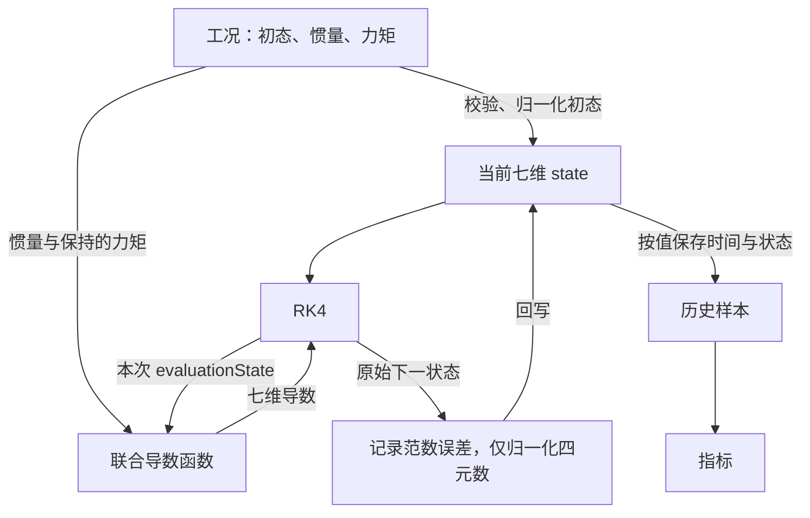

# 周一任务 A 至 C：七维旋转模型关系与接口

- 原任务日期：2026-09-28；实际执行日：2026-10-13。
- 本材料由 Codex 根据问答整理，来源 G；本人回答与提示情况见 [week8_done.md](week8_done.md)。物理量单位按本人要求暂时略过。

## 物理量与联合状态

| 物理量 | 角色 | 坐标系或映射含义 |
|---|---|---|
| $M_B$ | 输入：机体系外力矩 | FRD 机体系，关于质心 |
| $J$ | 参数：刚体惯量 | FRD 机体系；机体轴与惯量主轴重合，取对角矩阵 |
| $q_{NB}$ | 状态：姿态四元数 | 表示 B→N，分量顺序为 `[w,x,y,z]` |
| $\omega_B$ | 状态：角速度 | FRD 机体系分量 |
| $\dot q_{NB}$ | 导数：四元数的变化率 | 对 $q_{NB}$ 四个分量求时间导数 |
| $\beta_B=\dot\omega_B$ | 导数：角加速度 | 机体系角速度分量的时间导数 |

$$
x=[q_w,q_x,q_y,q_z,\omega_x,\omega_y,\omega_z]^{\mathsf T},
\qquad
\dot x=[\dot q_w,\dot q_x,\dot q_y,\dot q_z,\beta_x,\beta_y,\beta_z]^{\mathsf T}.
$$

有 7 个存储元素、6 个独立状态变量、3 个转动自由度。四元数受单位范数约束；姿态与角速度共同提供预测旋转所需的当前信息。

## 求导与初始参考

$$
\dot q_{NB}=\frac12 q_{NB}\otimes[0,\omega_x,\omega_y,\omega_z]^{\mathsf T},
\qquad
\beta_B=J^{-1}[M_B-\omega_B\times(J\omega_B)].
$$

取 $J=\operatorname{diag}(0.02,0.03,0.04)$、$M_B=0$、$q_{NB}(0)=[1,0,0,0]^{\mathsf T}$、$\omega_B(0)=[1,2,3]^{\mathsf T}$：

$$
J\omega_B=[0.02,0.06,0.12]^{\mathsf T},\qquad
\omega_B\times(J\omega_B)=[0.06,-0.06,0.02]^{\mathsf T},
$$

$$
\dot x(0)=[0,0.5,1,1.5,-3,2,-0.5]^{\mathsf T}.
$$

这是 Codex 直接给出的纸面计算（G），尚未运行本周联合模型核对。

## 关系与数据归属



每次联合求导都从同一份 `evaluationState` 读取四元数和角速度。当前 `state` 用于后续推进，历史样本各自持有副本。初始化时也要校验、归一化四元数并保存首个样本；每个完整 RK4 步后仅归一化前四项，保留角速度大小。

第五周高度 PD 改变输入推力；未来角速度控制器改变输入力矩，实际状态由动力学和积分器推进。姿态外环可根据姿态误差产生期望角速度；本周正式联合模型仍使用工况指定的力矩。

## 接口草稿

以下声明属于 `aerial_control` 命名空间：

```cpp
StateVector attitudeRateDerivative(
    double timeS,
    const StateVector &state,
    const RotationalParameters &parameters,
    const RotationalInput &input);
```

`timeS` 按值传入；其他三个参数以只读引用传入。返回新的七维导数向量，按值返回。`state` 和返回值使用相同的存储类型，但分别表示状态与状态导数。函数声明和未实现的源文件框架已由 Codex 写入项目，函数体留待周二组合导数任务逐步完成。

本人已正确选择只读引用和按值返回（H）；完整声明由 Codex 根据本人选择补全（G）。状态定义、系统阶数及控制器阶数的独立解释仍未核验。
